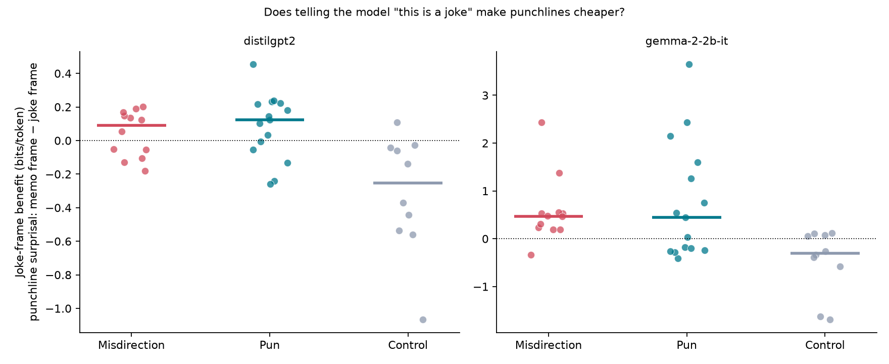
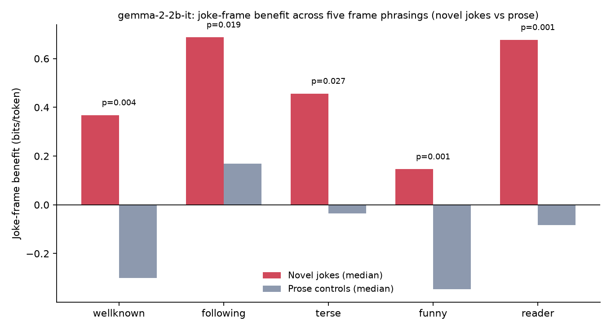
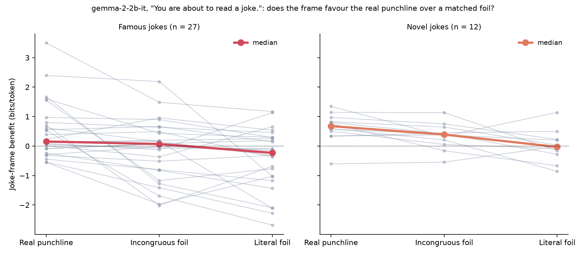
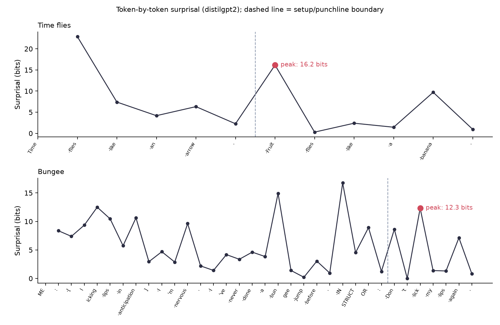

# The Math of Humour

**Do language models get the joke? Measuring humour in bits.**

Code, data and figures for the blog post **[Laughter as a Compression Dividend](https://viktor-bubanja.github.io/the-math-of-humour/)**. It treats a joke as model selection in Minimum Description Length terms, then uses small language models (82M to 2.6B parameters) as a measuring instrument to see which parts of that story show up in per-token surprisal.

## The idea

When you hear a joke, you entertain interpretations $M$ (scripts, word senses, frames). MDL scores each one as a two-part code:

```math
\text{MDL}(M;\, s, p) \;=\; \underbrace{L(M)}_{\text{choose an interpretation}} \;+\; \underbrace{-\log_2 p(s, p \mid M)}_{\text{encode setup } s \text{ and punchline } p \text{ under it}}
```

The setup makes an interpretation $M_1$ salient; the punchline is expensive under it and cheap under a second interpretation $M_2$ that the setup made look unlikely. The click is realising $\text{MDL}(M_2) \ll \text{MDL}(M_1)$. On this account, what makes a joke hard is the price of *choosing* $M_2$, not the cost of the words once you have.

A language model never commits to one interpretation. Its prediction is, in effect, a mixture, and a sum is at least as large as any of its terms:

```math
p(p \mid s) \;=\; \sum_M \pi(M \mid s)\, p(p \mid s, M)
\quad\Longrightarrow\quad
-\log p(p \mid s) \;\le\; \underbrace{-\log \pi(M_2 \mid s)}_{\text{cost of choosing } M_2} \;+\; \underbrace{-\log p(p \mid s, M_2)}_{\text{small once chosen}}
```

So the model's surprisal for a punchline already includes the cost of choosing the interpretation that resolves it. That gives two testable predictions:

1. Raise $\pi(M_2)$ before the punchline arrives, by telling the model what kind of text it's reading, and joke punchlines should get cheaper while prose shouldn't.
2. The saving should go to punchlines that $M_2$ actually explains, not to any surprising continuation.

## The measurement

Every experiment compares a punchline's mean surprisal (bits per token) under two one-sentence frames prepended to the same text, a joke frame ("You are about to read a joke.") and a memo frame ("You are about to read a factual memo."):

```math
\text{benefit} \;=\; \bar{S}\big(p \mid \text{memo frame},\, s\big) \;-\; \bar{S}\big(p \mid \text{joke frame},\, s\big),
\qquad
\bar{S} = \frac{1}{|p|}\sum_{t \in p} -\log_2 p(t \mid \text{everything before } t)
```

```python
benefit = (punchline_surprisal(model, tok, FRAME_MEMO, setup, punch)
         - punchline_surprisal(model, tok, FRAME_JOKE, setup, punch))
```

A saving of 0.5 bits per token means each punchline token became $2^{0.5} \approx 1.4\times$ more probable.

## What came out

### 1. Telling a model "this is a joke" makes joke punchlines cheaper



Under gemma-2-2b-it, jokes save a median ~0.5 bits per punchline token while prose is *penalised* by the joke frame (median −0.3); jokes vs prose separates at p = 0.001 (Cliff's δ = +0.72). The same interaction holds in distilgpt2, several times smaller. It survives 12 newly worded jokes that rule out verbatim recall of famous ones (E16) and five different frame wordings (E18):



### 2. In the larger model, it rewards resolution, not just surprise

Each of the 39 jokes keeps its setup and gets two matched foil punchlines, fixed before any framed run: an **incongruous** foil with the same length and shape that is at least as surprising with no frame but doesn't resolve the joke, and a boring **literal** one. Joke-frame benefit under gemma-2-2b-it, in bits per token:

| Setup | Real punchline | Incongruous foil | Literal foil |
|---|---|---|---|
| What do you call a fake noodle? | An impasta. **+1.67** | A Tuesday. −1.27 | A plastic noodle. −2.09 |
| I asked the librarian if they had books about paranoia. She whispered: | they're right behind you. **+0.70** | they're made of wet gravel. −2.01 | they're in aisle seven. −0.69 |
| I'm on a seafood diet. | I see food and I eat it. **+1.56** | I see trees and I paint them. −1.17 | I eat a lot of fish. −0.77 |
| I used to be a banker. | But I lost interest. **+3.50** | But I lost my umbrella. +1.49 | But I changed careers. +1.17 |



Across all 39 jokes the real punchline beats its foil in 28, by a median 0.21 bits per token (95% CI 0.08 to 0.38, Wilcoxon signed-rank p = 0.0001; newly worded jokes alone p = 0.016), in 4 of 5 frame phrasings. It's a gradient: resolution helps most, bare incongruity some, the literal continuation not at all. distilgpt2 shows the reverse (−0.07, p = 0.03): for the 82M model, "this is a joke" looks closer to "expect something odd".

### 3. What a language model can't see: the spike



`Fruit` costs 16 bits, then `flies` costs 0.3. It looks like the theory made visible, but over 37 texts no property of the spike (height, sharpness, recovery, or whether the setup makes the twist harder than no context) separates jokes from prose: the biggest spike in the corpus is in a memo about report deadlines. That's what the mixture bound predicts. Surprisal measures how *unlikely* the right reading looked, never the cost $S_1$ under the wrong one, so a model that hedges has nothing for a setup to mislead.

## All experiments

| # | Question | Model(s) | Result |
|---|---|---|---|
| E11 | Do peak surprisal / sharpness / recovery separate jokes from prose? | distilgpt2 | No: peak p ≥ 0.14, sharpness p ≥ 0.20; 32/37 texts "recover" in one token |
| E12 | Does the setup make the twist token *harder* to predict than no context? | distilgpt2, gpt2-large | No: weak trend at 82M (p = 0.06), gone at 774M |
| E13 | Same, at a larger instruction-tuned model | gemma-2-2b-it | No: p ≥ 0.49 |
| E14 | Does a "joke" frame make joke punchlines cheaper than a "factual" frame, relative to prose? | distilgpt2, gemma-2-2b-it | **Yes**: p = 0.001 in both, effect ~4× larger in gemma |
| E15 | Same with a blander wording | distilgpt2, gemma-2-2b-it | Gemma loses significance on these famous jokes (p = 0.20), which suggests a memorisation confound. distilgpt2 still separates (p = 0.016) |
| E16 | Does the effect survive on 12 newly worded jokes? | distilgpt2, gemma-2-2b-it | **Yes**: all 4 model × wording conditions, p = 0.004–0.038, δ = +0.53 to +0.73, bootstrap CIs exclude 0 |
| E17 | Does a "deliberate nonsense" frame specifically compress absurdist texts? | gemma-2-2b-it | Directionally yes (p = 0.008, n = 10); pilot only |
| E18 | Is E16 an artifact of one prompt wording? | gemma-2-2b-it | **No**: holds in 5/5 phrasings, p = 0.0009–0.027 |
| E19 | Does the frame favour a joke's real punchline over a matched foil that is at least as surprising but doesn't resolve the joke? | distilgpt2, gemma-2-2b-it | **Gemma: yes**. Real − foil benefit median +0.21 bits/token [95% CI +0.08, +0.38], p = 0.0001, 28/39 jokes; novel jokes alone p = 0.016. Holds in 4/5 phrasings (not "funny"). **distilgpt2: reversed** (−0.07, p = 0.03): its frame favours the stranger foil |

Per-item numbers are in [`results/`](results/) alongside every figure.

## Method

Every experiment is a variation on one function, [`humour/surprisal.py`](humour/surprisal.py). `punchline_surprisal` runs `BOS + prefix + setup + punchline` through the model in one teacher-forced pass and averages the punchline tokens' surprisal. The frame experiments then test whether `benefit` is larger for jokes than for prose (two-sided Mann-Whitney U, Cliff's δ, percentile-bootstrap CIs; [`humour/stats.py`](humour/stats.py)). Because the test is a jokes-vs-prose interaction, any effect of the prefixes that isn't joke-specific cancels out. E19 instead compares each joke's real punchline with its own matched foils (two-sided Wilcoxon signed-rank, matched-pairs rank-biserial r, bootstrap CI over jokes).

### Validity checks

| Threat | Check |
|---|---|
| Categories chosen to fit results | Categories and punchline boundaries fixed before any model run ([`humour/corpus.py`](humour/corpus.py)) |
| Per-item wording leaking hints | One uniform prefix for every text |
| Memorised famous jokes | 12 newly worded jokes (E16); one turned out to be a published joke, and the effect holds without it |
| Prompt sensitivity | 5 frame phrasings (E18) |
| Single-model quirks | 3 models, 82M to 2.6B parameters |
| Tokenizer merges across the setup/punchline boundary | [`tests/`](tests/) checks every frame × text pair, including E19's foils, under all three tokenizers |
| "The frame just likes surprising text" | E19: each joke's real punchline vs a matched foil of the same length and shape that is at least as surprising with no frame, but doesn't resolve the joke. Foils fixed and reviewed before any framed run |
| Off-by-one in reading probabilities | [`tests/`](tests/) checks surprisal against Hugging Face's own cross-entropy loss |
| Non-reproducible numbers | Pinned dependencies. Re-running `experiments/` reproduces the original CSVs byte-for-byte (E15 now also adds distilgpt2 rows) |

Two deliberate choices worth knowing about: `gemma-2-2b-it` gets raw text, not its chat template (the template would itself act as a frame), and all runs are on CPU (Gemma in bfloat16), so results don't depend on GPU kernels.

## Running it

```bash
uv venv --python 3.11 && uv pip install -e ".[dev]"
.venv/bin/python -m pytest tests                     # ~15s
.venv/bin/python experiments/e14_genre_frame.py      # writes results/genre_frame_results.csv + figure
```

`google/gemma-2-2b-it` is gated on Hugging Face: accept its licence and `huggingface-cli login` first. The distilgpt2 scripts take seconds. The Gemma ones take roughly 10–20 minutes each on a laptop CPU; E19, which scores 117 punchlines under 11 conditions, takes closer to an hour.

| Script | Experiments |
|---|---|
| `experiments/e11_corpus_sharpness.py` | E11 |
| `experiments/e12_context_effect.py` | E12; pass `google/gemma-2-2b-it` for E13 |
| `experiments/e14_genre_frame.py` | E14; pass `neutral` for E15 |
| `experiments/e16_novel_jokes.py` | E16 |
| `experiments/e17_absurdism_frame.py` | E17 |
| `experiments/e18_frame_sweep.py` | E18 |
| `experiments/e19_minimal_pairs.py` | E19 |

## Layout

```
humour/          shared code: corpus, surprisal, stats, plotting
experiments/     E11–E19, the experiments the post reports
exploratory/     E1–E10, early single-file probes on 4–5 texts each (superseded; kept for the record)
results/         CSVs and figures written by experiments/
tests/           tokenization-boundary, loss-equivalence and statistics checks
```

### Exploratory scripts (E1–E10)

These came first and ran on a handful of hand-picked texts. Several looked like strong results, and most didn't survive E11's move to a 37-text corpus with controls. They're kept as-is apart from one bug fix: `e08_model_scale.py` read punchline probabilities one position late and skipped the first punchline token. None of its numbers appear in the post.

| # | Probe | Outcome at the time |
|---|---|---|
| E1 | Setup-misleading ratio, PPL(punch \| setup) / PPL(punch) | Null |
| E2 | Token-level surprisal profile | Spike on the twist word (later shown to be generic, E11) |
| E3 | Embedding distance between punchline and sampled continuations | Null (shared prefix dominates the embedding) |
| E4 | Gini coefficient of whole-text surprisal | Null |
| E5 | Perplexity drop from an interpretation hint | Directional only |
| E6 | Post-peak recovery / "resolution sharpness" | Looked strong at n = 5, null at n = 37 (E11) |
| E7 | Retroactive compression of the setup given the punchline | Not joke-specific |
| E8 | Misleading ratio across GPT-2 sizes | Rises with scale, never crosses 1 |
| E9 | Gini of punchline tokens only | Null |
| E10 | Actual punchline vs greedy completion | Bungee punchline ~39× less probable per token (an anecdote, not used in the post) |
